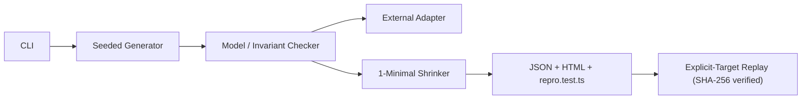

# PatchLab

[](https://github.com/fkher003/patchlab/actions/workflows/ci.yml)


**Model-based logic testing that finds stateful bugs, shrinks failing sequences, and exports replayable evidence.**

PatchLab is a zero-runtime-dependency TypeScript/Node.js developer tool. It checks refund services against an independent reference model and validates idempotency lock-store invariants. When a violation is found, PatchLab minimizes the failing operation sequence and generates a versioned JSON report, a static HTML report, and an executable Node test (`repro.test.ts`) with SHA-256 adapter provenance.

## Quick Demo (One Command)

Requires Node.js >= 24.12 (see `.node-version`) and npm. No API keys or external services required.

```bash
npm ci
npm run verify
npm run showcase
```

> On Windows PowerShell, use `npm.cmd` if `npm.ps1` is blocked by execution policy.

`npm run showcase` runs an end-to-end verification against a real public bug (`hono-idempotency #89`):

1. Runs the pinned upstream buggy store and detects `processing-key-lost`.
2. Shrinks the failing sequence from **30 operations down to 4** and writes `failure.json`, `report.html`, and `repro.test.ts`.
3. Replays the exact recorded sequence against the buggy store (`FAIL`) and the fixed store (`PASS`).
4. Executes the generated regression test against the fixed store (`PASS`).

### Sample Output

```text
1/4 Find and minimize the upstream store failure
FAIL processing-key-lost; 30 -> 4 operations (maxSize=2)
{
  "rule": "processing-key-lost",
  "step": 3,
  "operation": { "op": "get", "key": "k2" },
  "detail": "get() lost a key that is still processing"
}
[{"op":"lock","key":"k2"},{"op":"lock","key":"k3"},{"op":"lock","key":"k4"},{"op":"get","key":"k2"}]
Report: reports/lock-store-seed42-.../failure.json
Regression test: reports/lock-store-seed42-.../repro.test.ts
HTML: reports/lock-store-seed42-.../report.html

2/4 Replay the exact recorded sequence on the original adapter
{ rule: 'processing-key-lost', step: 3, operation: { op: 'get', key: 'k2' }, detail: 'get() lost a key that is still processing' }

3/4 Compare the fixed adapter (intentional source change)
PASS for recorded sequence only

4/4 Run the exported regression test against the fixed adapter
✔ external regression (3.96ms)
ℹ tests 1 | pass 1 | fail 0
Showcase complete. Open the report.html file printed above. Reports have been preserved.
```

See the [sample HTML report](docs/evidence/case001-report.html) (download and open in a browser) and the [case study](docs/CASE-001.md).

## Real-World Bug Reproduced

In `paveg/hono-idempotency` issue #89, an LRU cache with `maxSize = 2` evicts an active `processing` lock when new keys arrive:

```text
lock("k2")  →  lock("k3")  →  lock("k4")  →  get("k2")  ⇒  FAIL: processing-key-lost
```

Because `k2` is evicted while still in the `processing` state, a duplicate request for `k2` could bypass the idempotency lock while the first request is still running. PatchLab reproduces this against the pinned upstream parent commit and verifies that the upstream fix passes the exact same sequence.

_(Note: This reproduces a previously disclosed public bug to validate PatchLab; it is not a newly discovered vulnerability.)_

## Architecture



| Module                   | Responsibility                                                         |
| ------------------------ | ---------------------------------------------------------------------- |
| `src/model.ts`           | Independent reference model for refund state transitions               |
| `src/checker.ts`         | Compares refund service observations against the reference model       |
| `src/lockstore.ts`       | Stateful invariant checker for idempotency lock stores                 |
| `src/adapter.ts`         | Loads and validates external JS/TS adapter contracts                   |
| `src/external-report.ts` | Schema v3 validation, SHA-256 provenance, HTML/test export, and replay |
| `src/benchmark.ts`       | Deterministic multi-seed benchmark with optional check/shrink timing   |
| `src/cli.ts`             | Command-line entrypoint with strict argument validation and exit codes |

## Checking Your Own Module

External modules export a `create()` factory matching the contract in `docs/SPEC.md`.

```bash
npm run check-module -- test/fixtures/reject-adapter.mjs 42
npm run check-store -- examples/hono-parent.mjs 42
```

When a failure is found, PatchLab writes `failure.json`, `report.html`, and `repro.test.ts` into a unique directory under `reports/`. The report records the adapter filename and entry-file SHA-256 hash.

To replay a recorded failure against the original adapter or compare against a fix:

```bash
npm run replay-external -- <path/to/failure.json> examples/hono-parent.mjs
npm run replay-external -- <path/to/failure.json> examples/hono-fixed.mjs --allow-changed
```

**Security & provenance design:** Reports never auto-execute arbitrary file paths stored inside JSON. You must explicitly pass the adapter path on the CLI. By default, PatchLab verifies the entry-file SHA-256 hash _before_ calling `import()` and rejects modified files unless `--allow-changed` is explicitly set.

## CLI Commands & Exit Codes

| Command                                         | Description                                                             |
| ----------------------------------------------- | ----------------------------------------------------------------------- |
| `npm run showcase`                              | End-to-end upstream bug reproduction, report export, and regression run |
| `npm run demo`                                  | Minimal built-in refund model demonstration                             |
| `npm run check:buggy` / `check:fixed`           | Run checker against built-in refund implementations                     |
| `npm run check-module -- <adapter> [seed]`      | Check an external refund adapter                                        |
| `npm run check-store -- <adapter> [seed]`       | Check an external idempotency lock-store adapter                        |
| `npm run replay -- <report> <buggy\|fixed>`     | Replay built-in reports (schema v1/v2)                                  |
| `npm run replay-external -- <report> <adapter>` | Replay external reports (schema v3)                                     |
| `npm run benchmark -- 500`                      | Deterministic 500-seed benchmark across 5 targets                       |
| `npm run benchmark:timing`                      | Benchmark with separate check/shrink timings and environment info       |
| `npm run verify`                                | Strict TypeScript typecheck, Prettier check, and full test suite        |

**Exit codes:** `0` = no violation found (or expected showcase/demo outcome succeeded), `1` = logic violation detected, `2` = invalid arguments, malformed report, or broken adapter contract.

## Benchmark & Known Limitations

Across **500 deterministic seeds per target**:

| Target                              | Failing Seeds (out of 500) | Expected |
| ----------------------------------- | -------------------------- | -------- |
| `refund: buggy` (simulated)         | 499                        | Fails    |
| `refund: always-reject` (simulated) | 500                        | Fails    |
| `refund: fixed`                     | 0                          | Passes   |
| `store: hono-parent` (upstream bug) | 431                        | Fails    |
| `store: hono-fixed` (upstream fix)  | 0                          | Passes   |

Current test suite: **31 automated tests** covering model invariants, adapter contracts, SHA-256 provenance, cross-directory regression execution, CLI exit codes, benchmark timing, and end-to-end showcase runs.

**Scope & limitations:**

- **Trusted code only:** External adapters execute with the current user's Node.js permissions; there is no sandbox or per-operation timeout yet.
- **Entry-file hashing:** SHA-256 provenance hashes the adapter entry file, not transitive imports.
- **Local minimality:** The shrinker guarantees 1-minimality (no single operation can be removed while preserving failure), not global minimality.
- **Single-threaded in-memory scope:** Concurrency races, TTL expiration, crash recovery, and real database backends are not yet modeled.
- **No false guarantees:** Passing a seeded test suite is not a formal proof of correctness; reference models themselves can have bugs and are tested independently.

## Documentation

- [Architecture](docs/ARCHITECTURE.md)
- [Specification & Adapter Contracts](docs/SPEC.md)
- [Case Study 001: hono-idempotency #89](docs/CASE-001.md)
- [Benchmark Methodology & Timings](docs/BENCHMARK.md)
- [Changelog](CHANGELOG.md)
- [Contributing](CONTRIBUTING.md)

## Attribution & License

PatchLab is licensed under the [MIT License](LICENSE).

Pinned upstream source code used for Case Study 001 is stored under `vendor/hono-idempotency` with its original MIT `LICENSE` and `NOTICE`. PatchLab is not affiliated with or endorsed by the upstream project.
