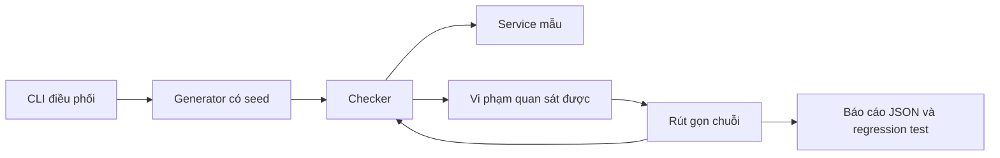

# Kiến trúc và ranh giới trách nhiệm

## Kiến trúc đang có

| Module hiện tại       | Trách nhiệm                                   | Không chịu trách nhiệm             |
| --------------------- | --------------------------------------------- | ---------------------------------- |
| src/refunds.ts        | Contract và hai implementation mô phỏng       | Database, network, đồng thời       |
| src/generator.ts      | Sinh chuỗi xác định theo seed                 | Xác định đúng/sai                  |
| src/checker.ts        | Quan sát quy tắc và rút gọn chuỗi lỗi         | Ghi file hoặc gọi LLM              |
| src/adapter.ts        | Nạp và kiểm tra contract module ngoài         | Sandbox, chạy mã không tin cậy     |
| src/cli.ts            | Nhận tham số, điều phối, đọc/ghi kết quả      | Được dùng như một security sandbox |
| test/patchlab.test.ts | Test nghiệp vụ và engine                      | Chứng minh mọi đầu vào đều đúng    |
| test/cli.test.ts      | Contract CLI, exit code, replay và regression | Benchmark hiệu năng                |

Giữ cấu trúc nhỏ trong giai đoạn nền móng. Không tạo services/controllers/repositories rỗng. Khi PL-102 triển khai adapter, tách contract khỏi service mẫu và để engine phụ thuộc contract thay vì implementation.

## Quyết định thiết kế được chấp nhận

- CLI chạy cục bộ trước: giảm phạm vi và làm replay/CI đơn giản. Chưa chạy mã không tin cậy.
- TypeScript dùng để tái sử dụng nền tảng hiện có; giá trị nằm ở phép kiểm chứng, không phải lựa chọn ngôn ngữ.
- Node test runner để ít dependency; tsc kiểm tra kiểu riêng vì Node chỉ xóa type khi chạy.
- Chạy tuần tự, in-memory: dễ tái hiện; không suy ra an toàn trong tình huống đồng thời.
- Shrinker xóa từng thao tác đến mức không thể xóa đơn lẻ thêm; chưa là cực tiểu toàn cục.
- Checker so sánh status và tổng hoàn với src/model.ts (mô hình tham chiếu viết từ SPEC, không gọi service) nên bắt service luôn từ chối (PL-101, đang Review). Giới hạn: model do cùng người viết có thể hiểu sai SPEC giống implementation; vẫn cần test ví dụ độc lập.

## Thiết kế đích sau nền móng

Contract adapter → generator và engine độc lập → model tham chiếu → report có version → CLI. Chỉ chuyển file khi ticket tương ứng được thực hiện để tránh hai kiến trúc cùng tồn tại.

## Tin cậy và dữ liệu

Report là dữ liệu đầu vào, phải validate trước replay. Phiên bản hiện tại chưa kiểm tra schema version (PL-103). Test tích hợp dùng thư mục tạm để không ghi đè báo cáo của người học. Không đưa token, .env hoặc dữ liệu khách hàng vào repository. CI chỉ cần quyền đọc nội dung và không cần API key.
